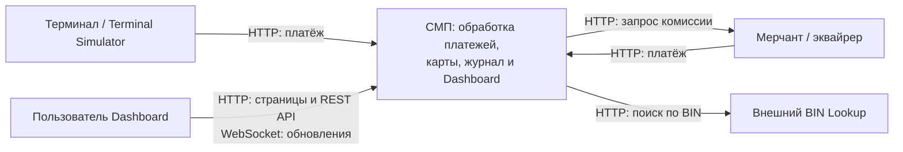

# A1. Контекст СМП

В [исходной схеме](../../architecture.md) не была выделена граница системы. Здесь СМП показана целиком, а терминал, мерчант и внешний справочник — как её окружение.

Terminal Simulator и Merchant-Acquirer заменяют внешних участников на учебном стенде. BIN Lookup также запускается локально, но для обработки платежа остаётся внешним справочником. PostgreSQL и RabbitMQ находятся внутри СМП; их показывает [Container](02-containers.md).

Подтверждение по коду:

- [GatewayClient терминала](../../../services/terminal-simulator/src/main/java/com/processing/terminalsimulator/client/GatewayClient.java) и [GatewayClient мерчанта](../../../services/merchant-acquirer/src/main/java/com/processing/merchantacquirer/client/GatewayClient.java) отправляют платежи в Gateway.
- [MerchantAcquirerClient](../../../services/switch/src/main/java/com/processing/service/MerchantAcquirerClient.java) запрашивает комиссию, [BinLookupClient](../../../services/authorization/src/main/java/com/processing/authorization/client/BinLookupClient.java) обращается к BIN Lookup.
- [nginx Dashboard](../../../services/dashboard/nginx.conf) отдаёт страницы и проксирует `/api/` и `/ws/`; [useWebSocket](../../../services/dashboard/src/hooks/useWebSocket.ts) подключается к `/ws/transactions`.
