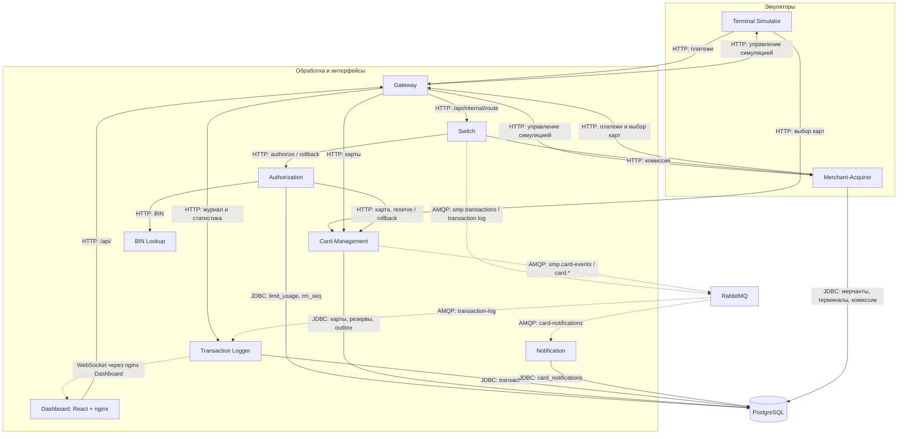

# A2. Сервисы и связи

В [исходной схеме](../../architecture.md) не различались HTTP и AMQP. Добавлены типы связей, запрос комиссии и пути событий через RabbitMQ; состав сверён с [docker-compose.yaml](../../../docker-compose.yaml).

Сплошные стрелки — синхронные HTTP/JDBC. Пунктир — асинхронная доставка AMQP и обновления WebSocket. Dashboard не обращается к RabbitMQ.

В Compose **10 прикладных сервисов**, PostgreSQL и RabbitMQ. В задании указано 11, но отдельного одиннадцатого приложения в этой версии нет. `common` — библиотека, `e2e-tests` — тестовый модуль. Prometheus, Grafana, Loki, Promtail и autoscaler относятся к дополнительному профилю `observability`.

| Связи | Подтверждение |
|---|---|
| Gateway → сервисы | [Маршруты Gateway](../../../services/gateway/src/main/resources/application.yml) |
| Switch → Authorization, Merchant-Acquirer, RabbitMQ | [RouteService](../../../services/switch/src/main/java/com/processing/service/RouteService.java), [AuthorizationClient](../../../services/switch/src/main/java/com/processing/service/AuthorizationClient.java), [LoggerClient](../../../services/switch/src/main/java/com/processing/service/LoggerClient.java) |
| Authorization → CMS, BIN, PostgreSQL | [AuthServiceImpl](../../../services/authorization/src/main/java/com/processing/authorization/services/AuthServiceImpl.java), [LimitUsageRepository](../../../services/authorization/src/main/java/com/processing/authorization/repositories/LimitUsageRepository.java) |
| CMS → PostgreSQL и RabbitMQ | [CardServiceImpl](../../../services/card-management/src/main/java/com/processing/cardmanagement/services/CardServiceImpl.java), [OutboxEventProcessorImpl](../../../services/card-management/src/main/java/com/processing/cardmanagement/services/OutboxEventProcessorImpl.java) |
| Потребители RabbitMQ → БД | [TransactionLogListener](../../../services/transaction-logger/src/main/java/com/processing/transactionlogger/listener/TransactionLogListener.java), [CardEventListener](../../../services/notification-service/src/main/java/com/processing/notification/listener/CardEventListener.java) |
| Симуляторы, БД мерчанта, Dashboard | [Terminal GatewayClient](../../../services/terminal-simulator/src/main/java/com/processing/terminalsimulator/client/GatewayClient.java), [Merchant GatewayClient](../../../services/merchant-acquirer/src/main/java/com/processing/merchantacquirer/client/GatewayClient.java), [репозитории Merchant-Acquirer](../../../services/merchant-acquirer/src/main/java/com/processing/merchantacquirer/repository/), [nginx](../../../services/dashboard/nginx.conf) |
