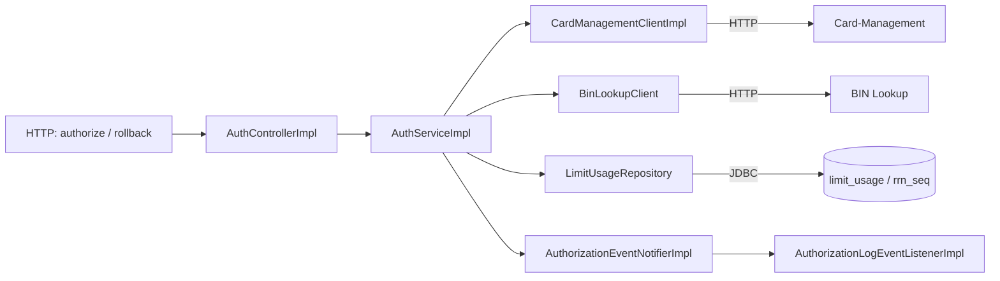
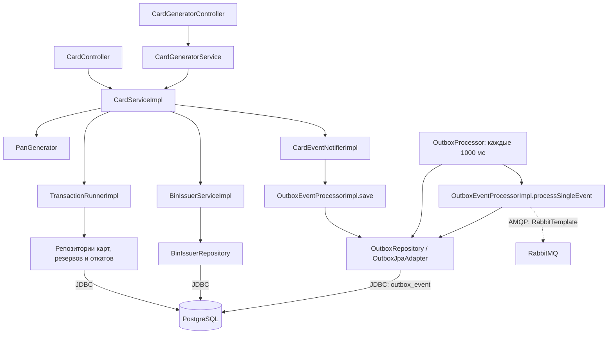

# A3. Компоненты Authorization и Card-Management

В проекте не было схем внутреннего устройства этих сервисов. Добавлены компоненты, границы HTTP/JDBC и отдельная публикация outbox.

## Authorization

[AuthControllerImpl](../../../services/authorization/src/main/java/com/processing/authorization/controller/AuthControllerImpl.java) преобразует результат в HTTP-статус. [AuthServiceImpl](../../../services/authorization/src/main/java/com/processing/authorization/services/AuthServiceImpl.java) получает карту, вызывает BIN Lookup, проверяет статус, срок и баланс, затем обновляет лимиты и резервирует средства. [LimitUsageRepository](../../../services/authorization/src/main/java/com/processing/authorization/repositories/LimitUsageRepository.java) выполняет SQL upsert и выдаёт блок RRN.

[CardManagementClientImpl](../../../services/authorization/src/main/java/com/processing/authorization/client/CardManagementClientImpl.java) и [BinLookupClient](../../../services/authorization/src/main/java/com/processing/authorization/client/BinLookupClient.java) — HTTP-зависимости. [События Authorization](../../../services/authorization/src/main/java/com/processing/authorization/events/AuthorizationEventNotifierImpl.java) передаются [локальному слушателю логов](../../../services/authorization/src/main/java/com/processing/authorization/listeners/AuthorizationLogEventListenerImpl.java), а не в RabbitMQ.

## Card-Management

Стрелка через `TransactionRunnerImpl` обозначает выполнение операций внутри транзакции; репозитории вызывает `CardServiceImpl`. При reserve/rollback/PATCH/DELETE он сохраняет событие в outbox. Отдельный планировщик выбирает `PENDING` и отправляет их в брокер.

| Компоненты | Подтверждение |
|---|---|
| HTTP и бизнес-операции | [CardController](../../../services/card-management/src/main/java/com/processing/cardmanagement/controllers/CardController.java), [CardGeneratorController](../../../services/card-management/src/main/java/com/processing/cardmanagement/controllers/CardGeneratorController.java), [CardServiceImpl](../../../services/card-management/src/main/java/com/processing/cardmanagement/services/CardServiceImpl.java) |
| Генерация и BIN | [CardGeneratorService](../../../services/card-management/src/main/java/com/processing/cardmanagement/services/CardGeneratorService.java), [PanGenerator](../../../services/card-management/src/main/java/com/processing/cardmanagement/services/PanGenerator.java), [BinIssuerServiceImpl](../../../services/card-management/src/main/java/com/processing/cardmanagement/services/BinIssuerServiceImpl.java) |
| Транзакции и хранение | [TransactionRunnerImpl](../../../services/card-management/src/main/java/com/processing/cardmanagement/services/TransactionRunnerImpl.java), [репозитории](../../../services/card-management/src/main/java/com/processing/cardmanagement/repositories/) |
| Outbox | [CardEventNotifierImpl](../../../services/card-management/src/main/java/com/processing/cardmanagement/events/CardEventNotifierImpl.java), [OutboxProcessor](../../../services/card-management/src/main/java/com/processing/cardmanagement/services/OutboxProcessor.java), [OutboxEventProcessorImpl](../../../services/card-management/src/main/java/com/processing/cardmanagement/services/OutboxEventProcessorImpl.java), [настройки](../../../services/card-management/src/main/resources/application.properties) |

Для unit подходят правила и обработка ошибок с подменой клиентов/репозиториев. SQL, блокировки и доставку сообщений нужно проверять с настоящими PostgreSQL и RabbitMQ.
