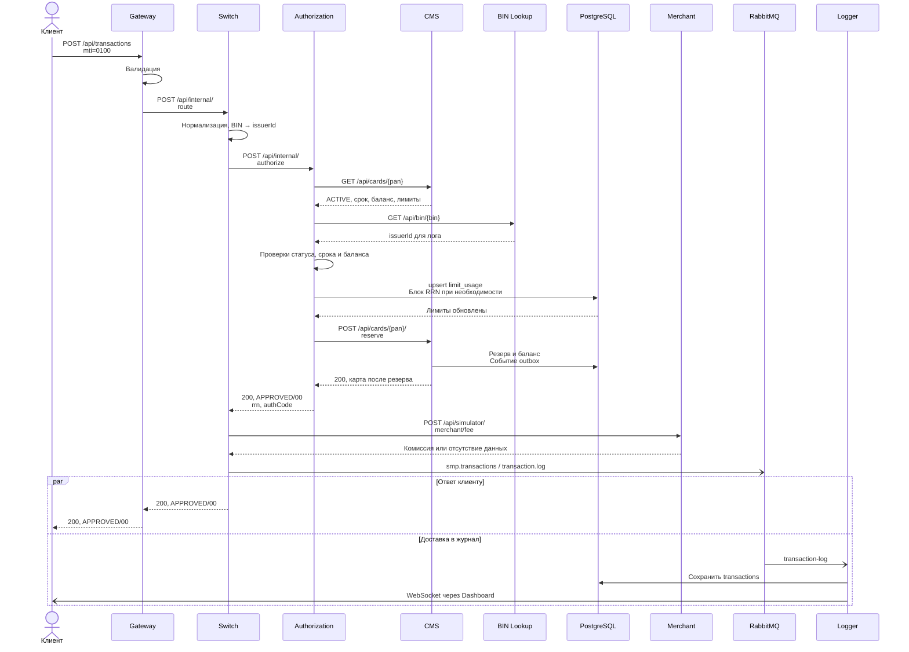
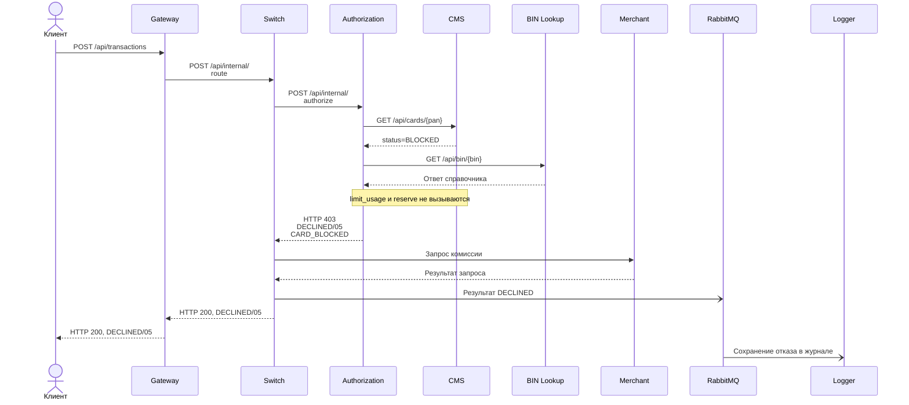
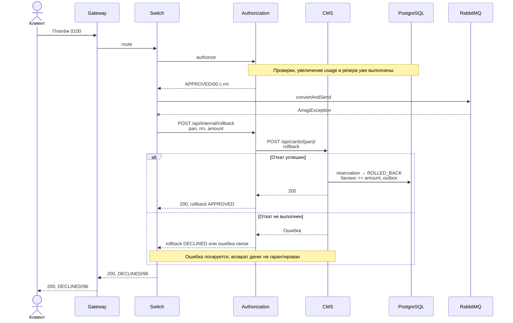

# A4. Путь платежа

В исходной документации был только успешный путь. Добавлены отказ и откат, исправлен порядок вызовов CMS/BIN. `->>` — синхронный вызов, `-->>` — ответ, `-)` — асинхронная доставка.

## Успешный платёж

Обновление outbox → Notification идёт независимо, см. [RabbitMQ](05-rabbitmq.md). Запись в журнале может появиться до или после HTTP-ответа: проверяется её появление за время ожидания, а не строгий порядок этих двух событий.

## Отказ: карта BLOCKED

HTTP-статус и `responseCode` — разные поля. Authorization возвращает 403, Switch передаёт бизнес-отказ в HTTP 200.

## Откат после ошибки публикации

По [ТЗ Switch, п. 3–4](../../../tz/03-switch.md) reversal обозначается `mti=0400` и должен запускаться при отсутствии publisher-confirm за 2 секунды. В коде откат — отдельный HTTP-запрос без MTI. `publisher-confirm-type: correlated` включён, но `LoggerClient` не ждёт подтверждения: откат начинается только при исключении отправки. `AuthServiceImpl.rollback()` вызывает CMS и не уменьшает `limit_usage`. Эти различия учтены в новых кейсах P3-10 и в [состояниях](06-states.md).

Подтверждение: [маршруты Gateway](../../../services/gateway/src/main/resources/application.yml), [RouteController](../../../services/switch/src/main/java/com/processing/controller/RouteController.java), [RouteService](../../../services/switch/src/main/java/com/processing/service/RouteService.java), [AuthorizationClient](../../../services/switch/src/main/java/com/processing/service/AuthorizationClient.java), [LoggerClient](../../../services/switch/src/main/java/com/processing/service/LoggerClient.java), [настройки Switch](../../../services/switch/src/main/resources/application.yml), [AuthControllerImpl](../../../services/authorization/src/main/java/com/processing/authorization/controller/AuthControllerImpl.java), [AuthServiceImpl](../../../services/authorization/src/main/java/com/processing/authorization/services/AuthServiceImpl.java), [CardServiceImpl](../../../services/card-management/src/main/java/com/processing/cardmanagement/services/CardServiceImpl.java), [TransactionService](../../../services/transaction-logger/src/main/java/com/processing/transactionlogger/service/TransactionService.java).
