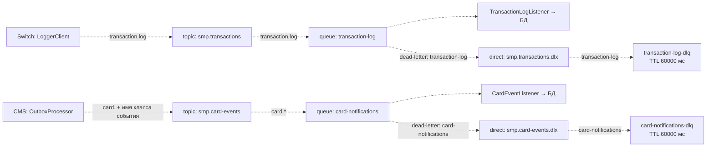

# A5. RabbitMQ

В проекте топология была описана текстом. Добавлена схема двух путей событий, dead-letter-очереди и отличия между повторной отправкой outbox и повторной доставкой потребителю.

Все стрелки на этой схеме — async AMQP. Основные exchange и очереди durable. TTL 60 секунд относится к **сообщениям в DLQ**, это не задержка перед повторной попыткой.

| Механизм | Что есть в коде |
|---|---|
| Publisher confirms | В Switch включён `correlated`, но `LoggerClient.log()` возвращает true сразу после `convertAndSend`. Ожидания ACK/NACK в течение 2 секунд нет |
| Ошибка отправки Switch | `AmqpException` → false; для уже одобренного платежа `RouteService` вызывает rollback и возвращает 96 |
| Outbox CMS | Период 1000 мс. При ошибке отправки растёт `retryCount`; третья ошибка переводит событие в `FAILED`. Планировщик выбирает только `PENDING` с числом попыток меньше 3 |
| Успешный send outbox | Событие помечается `PROCESSED`. Это ещё не подтверждение записи в Notification |
| Повторная доставка потребителю | У очередей записан аргумент `x-max-delivery=3`, но он не обеспечивает заявленный лимит RabbitMQ. Поэтому три попытки → DLQ требуют отдельной проверки, а не считаются реализованными |

Для RabbitMQ 3.13 ограничение доставок описано для quorum queues через `x-delivery-limit`, а здесь quorum не объявлена: [документация RabbitMQ](https://www.rabbitmq.com/docs/3.13/quorum-queues#poison-message-handling). Наличие DLX само по себе не останавливает бесконечный requeue при ошибке обработчика.

Подтверждение по коду:

- Топология: [Switch RabbitMQConfig](../../../services/switch/src/main/java/com/processing/config/RabbitMQConfig.java), [Logger RabbitMQConfig](../../../services/transaction-logger/src/main/java/com/processing/transactionlogger/config/RabbitMQConfig.java), [CMS RabbitMQConfig](../../../services/card-management/src/main/java/com/processing/cardmanagement/config/RabbitMQConfig.java), [Notification RabbitMQConfig](../../../services/notification-service/src/main/java/com/processing/notification/config/RabbitMQConfig.java).
- Публикация: [LoggerClient](../../../services/switch/src/main/java/com/processing/service/LoggerClient.java), [настройки Switch](../../../services/switch/src/main/resources/application.yml), [OutboxProcessor](../../../services/card-management/src/main/java/com/processing/cardmanagement/services/OutboxProcessor.java), [OutboxEventProcessorImpl](../../../services/card-management/src/main/java/com/processing/cardmanagement/services/OutboxEventProcessorImpl.java), [OutboxJpaAdapter](../../../services/card-management/src/main/java/com/processing/cardmanagement/repositories/OutboxJpaAdapter.java), [настройки CMS](../../../services/card-management/src/main/resources/application.properties).
- Потребители: [TransactionLogListener](../../../services/transaction-logger/src/main/java/com/processing/transactionlogger/listener/TransactionLogListener.java), [CardEventListener](../../../services/notification-service/src/main/java/com/processing/notification/listener/CardEventListener.java).
