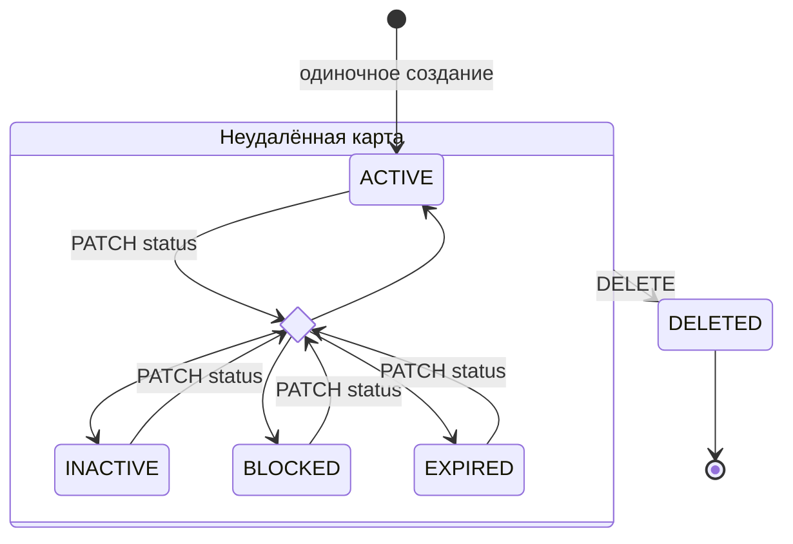
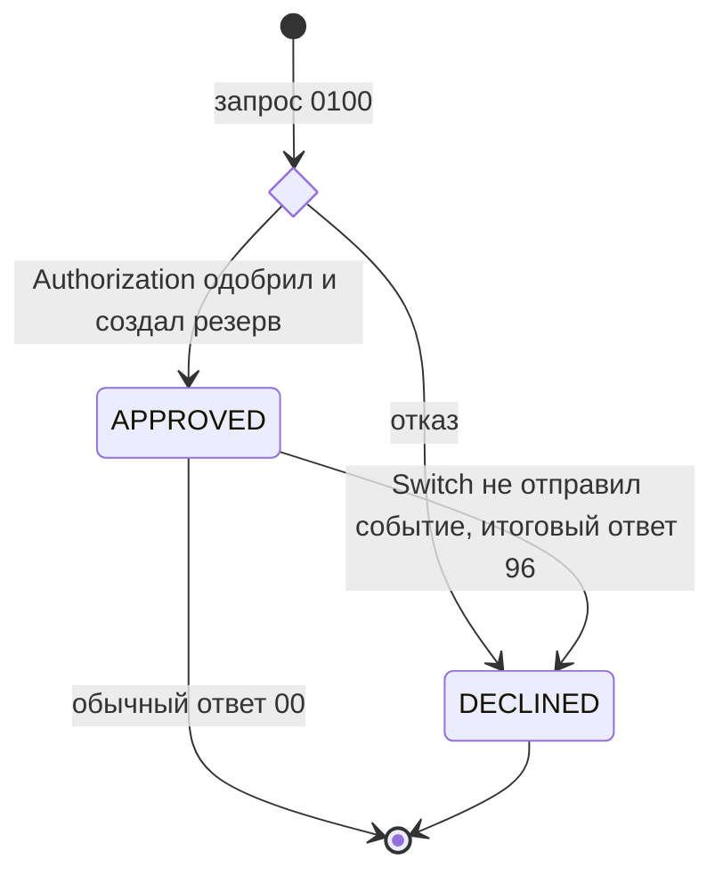
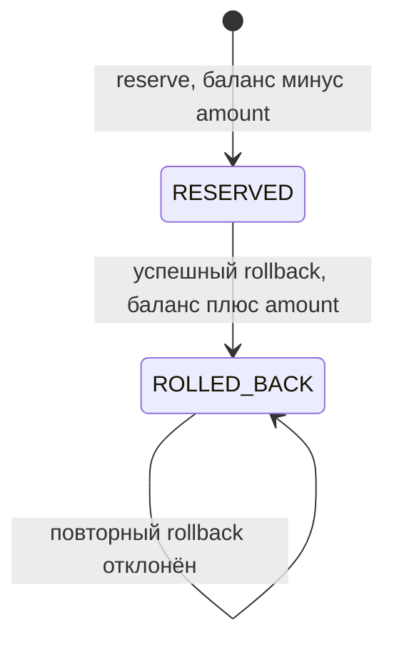

# A6. Состояния карты и платежа

В проекте не было диаграмм состояний. Добавлены переходы карты и результата платежа; отдельно показан резерв, которому в коде принадлежит статус `ROLLED_BACK`.

## Карта

`CHANGE` — узел выбора, не статус карты. PATCH принимает четыре публичных статуса; отдельного запрета BLOCKED → ACTIVE нет. Генератор может сразу создавать разные статусы. DELETE устанавливает внутренний `DELETED`; строка остаётся в БД, но скрывается `@SQLRestriction`. Проверка истёкшего срока в Authorization возвращает отказ и сама не меняет статус карты.

## Результат транзакции

Это последовательность решений разных сервисов, а не обновление одной строки в БД. В `TransactionStatus` есть только `APPROVED` и `DECLINED`. При сбое публикации Switch не отправляет в Logger исправленный результат после rollback.

## Резерв и откат

По заданию бизнес-жизненный цикл транзакции включает `APPROVED → ROLLED_BACK` при reversal 0400. В реализации это переход **резерва** через отдельный rollback endpoint. Возврат баланса есть; восстановления `limit_usage` в Authorization нет. После неудачного rollback резерв может остаться `RESERVED`, хотя клиент уже получил 96.

| Переходы | Подтверждение |
|---|---|
| Статусы, PATCH и удаление карты | [CardStatus](../../../services/card-management/src/main/java/com/processing/cardmanagement/models/CardStatus.java), [CardModelStatus](../../../services/common/src/main/java/com/processing/common/dto/cardmanagement/CardModelStatus.java), [Card.withData / deleted](../../../services/card-management/src/main/java/com/processing/cardmanagement/models/Card.java), [CardServiceImpl](../../../services/card-management/src/main/java/com/processing/cardmanagement/services/CardServiceImpl.java), [CardEntity](../../../services/card-management/src/main/java/com/processing/cardmanagement/models/CardEntity.java) |
| Одобрение и отказ | [AuthServiceImpl](../../../services/authorization/src/main/java/com/processing/authorization/services/AuthServiceImpl.java), [DeclineOutcome](../../../services/authorization/src/main/java/com/processing/authorization/constants/DeclineOutcome.java), [TransactionStatus](../../../services/common/src/main/java/com/processing/common/dto/transactionlogger/TransactionStatus.java), [RouteService](../../../services/switch/src/main/java/com/processing/service/RouteService.java) |
| Резерв и rollback | [Reservation](../../../services/card-management/src/main/java/com/processing/cardmanagement/models/Reservation.java), [ReservationStatus](../../../services/card-management/src/main/java/com/processing/cardmanagement/models/ReservationStatus.java), [CardServiceImpl.rollback](../../../services/card-management/src/main/java/com/processing/cardmanagement/services/CardServiceImpl.java) |

Переходы объекта можно проверять в unit. Сохранение статуса и денег — integration. Платёж после блокировки карты через публичный Gateway — E2E.
